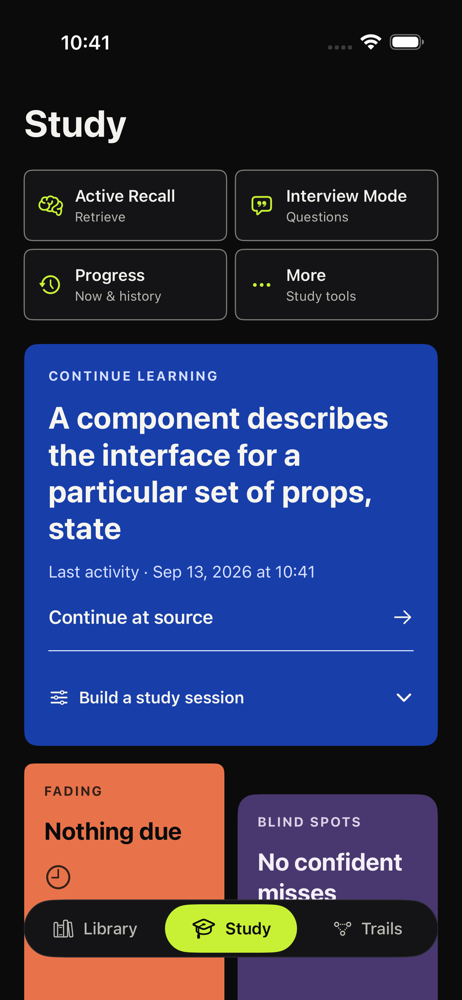
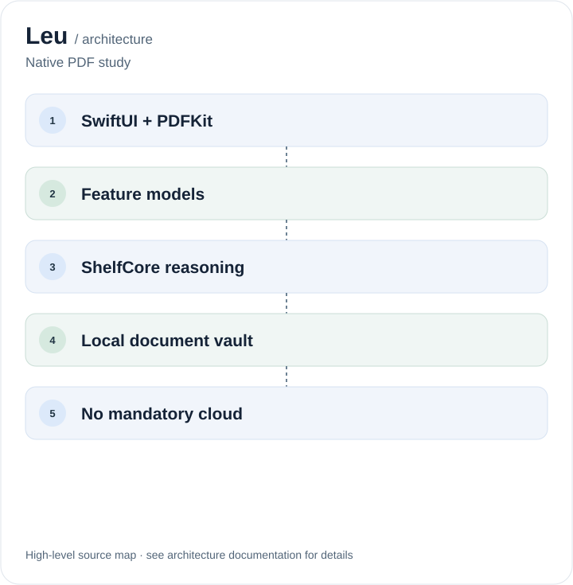

# Leu

**A PDF reader built around understanding and recall.**

[Try the browser companion](https://leu.miguelalmeida.xyz/) · [Native architecture](docs/ARCHITECTURE.md) · [Repository guide](docs/START_HERE.md)

Leu keeps study actions close to the document: explain a passage, test recall, revisit weak concepts and return to the original page. The native iPhone app uses SwiftUI and PDFKit. The linked browser demo is a **separate React/Vite companion**, not the iOS build.

<p align="center">
  
</p>
<p align="center"><sub>Native Study screen · retained capture, not a current device test</sub></p>

## Reading and study

- **Stay in the document.** Read, navigate and annotate PDFs without moving the source out of view.
- **Work through difficult passages.** Explanation and recall are tied to the passage being studied.
- **Find what needs another pass.** Blind spots and reconstruction support revisiting the original material.

## Engineering

- **Native reader:** SwiftUI presentation and feature models call focused services. `PDFSessionController` owns the visible PDFKit view; `Packages/ShelfCore/` holds portable learning contracts.
- **Local data:** `LibraryRepository` serializes updates; `DocumentVault` and validated snapshots persist the library. Annotations are stored separately from original PDF bytes.
- **Browser companion:** `web/` uses React, Vite and PDF.js with browser-local PDFs and state. Its storage and runtime are independent of the native app.

## Architecture

<p align="center">
  <picture>
    <source media="(max-width: 640px)" srcset="./docs/readme/architecture-mobile.svg">
    
  </picture>
</p>

The diagram describes the native path. [Architecture decisions](docs/ARCHITECTURE.md) document the import, persistence and concurrency boundaries.

## Run locally

Native iOS requires macOS, full Xcode 16+ and an iOS 17+ simulator:

```sh
./run.sh --build
./run.sh
```

The browser companion runs without Xcode:

```sh
cd web
npm ci
npm run build
npm run dev
```

## Verification and scope

Portable logic tests and native device journeys are separate checks. A successful build does not certify gestures, PDF interaction or on-device model behavior. See the [test guide](docs/TESTING.md) and [release checklist](docs/RELEASE_CHECKLIST.md). Experimental learning paths are not presented as fully verified releases.

Built by [Miguel Almeida](https://github.com/miguelalmeida0).
